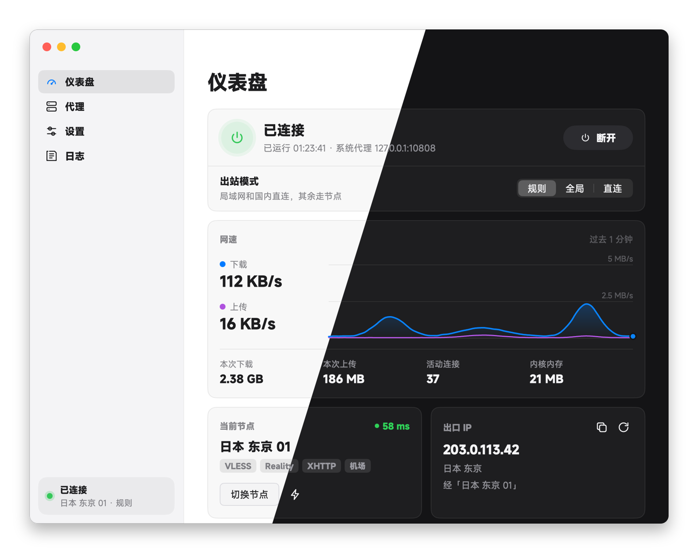
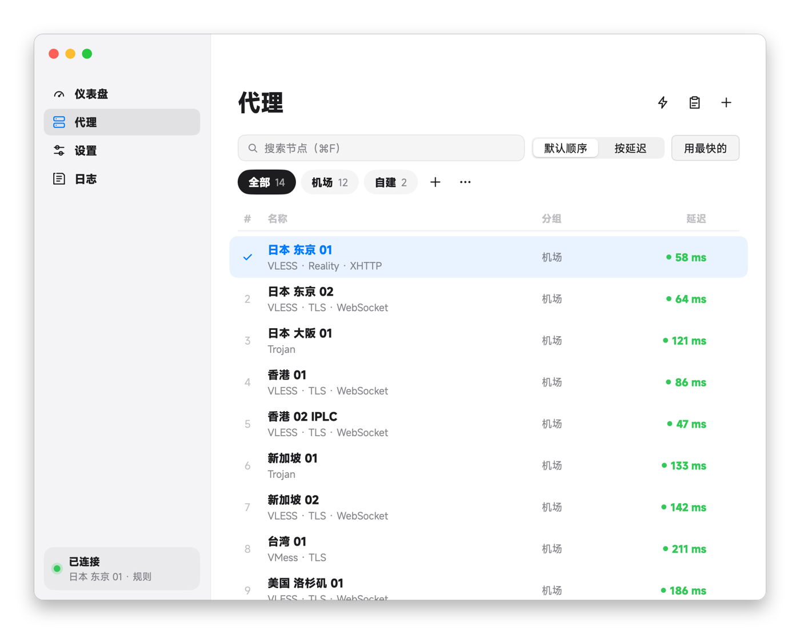
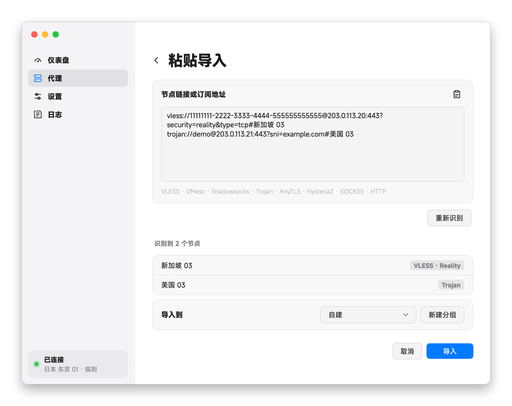
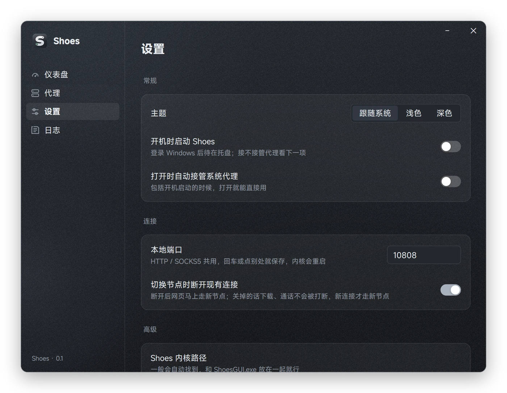
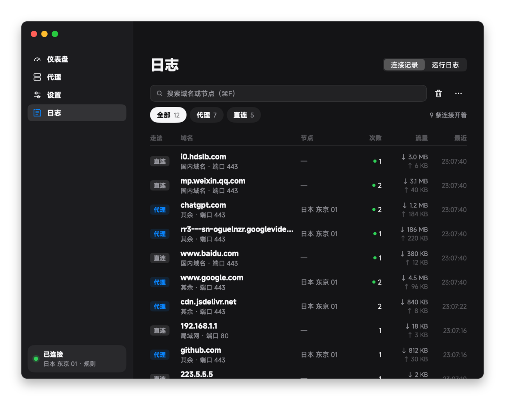

<div align="center">


# MyShoes

原名 Shoes / ShoesGUI。macOS 使用系统默认字体；Windows 继续使用 MiSans。配置目录、钥匙串标识、单实例锁、仓库和更新签名保持兼容旧版。安装包和应用显示名为 MyShoes；内部程序仍叫 ShoesGUI，保证旧版更新后能正常重启。

一个顺手的 Windows / macOS 代理客户端

给 [shoes](https://github.com/cfal/shoes) 内核做的原生图形界面：订阅一键更新、v2rayN 同款测速、规则分流、托盘常驻。

     



</div>

## 为什么用它

**打开就能用。** 内核随 MyShoes 一起常驻，仪表盘上的「连接」只负责接管系统代理。没点连接也能测速，也能把 `127.0.0.1:10808` 直接填给别的程序。

**订阅是活的。** 订阅地址绑在分组上，点「更新订阅」时同名节点就地换成新配置，新出的补上，下架的删掉；你手动加进这一组的节点不会被碰。读订阅时报的是 v2rayN 的 User-Agent，机场会回分享链接，而不是一整份 Clash YAML。

**测速和 v2rayN 一样准。** 「真连接延迟」另起一个只用来测速的内核，经每个节点连发两次 `generate_204` 取较小的那次；也有 TCPing。可以按延迟排序，一键「用最快的」；结果跟着节点配置走，换了配置或更新了订阅就清零重测。

**状态不骗人。** 网速曲线（指针放上去能看那一秒的上下行）、本次流量、活动连接、内核内存、真实出口 IP 都在仪表盘上，侧栏底部随时看得到连没连上、用的哪个节点；没接管系统代理时，出口卡会直接告诉你浏览器现在是直连。

**安静地待在托盘。** 关窗口只是收进托盘（macOS 上是顶部菜单栏），右键能连接断开、切节点、切模式；图标灰色是没接管，绿色是接管中。

**看得到每个网站怎么走。** 日志页的「连接记录」像 v2rayN 的连接页，列出每个域名走了直连还是经哪个节点、命中哪条规则（国内域名、国内 IP、局域网、其余）、连了几次、多少流量，能只看代理或只看直连、能搜，右键能复制域名或断开它的连接。记录只放在内存里，退出 MyShoes 就清空。

**日志说人话。** 常见的单条连接报错翻成中文、一分钟内合并计数，默认只看重要的，报错标红，能搜、能选中复制、能一键复制给别人看。

**数据留在本机。** 节点和设置加密后存在本机：Windows 用 DPAPI，放在 `%APPDATA%\ShoesGUI`；macOS 用 AES-256-GCM，密钥放在登录钥匙串里，数据放在 `~/Library/Application Support/ShoesGUI`。改系统代理前先记一份恢复日志，就算程序意外退出，下次打开也会把原来的代理设置还回去。

**更新点一下就好。** 有新版本时侧栏会提示，到「设置 › 关于」点「更新并重启」，MyShoes 会下载、校验签名、替换文件，然后自己重新打开；更新前接管着系统代理的话，重新打开后接着接管。更新包都用发布者的私钥签过名，签名对不上就不装。下载走 MyShoes 自己的内核（国内直连 GitHub 常常很慢），节点不通再直连。更新时只下载变动的部分，内核也跟着一起更新。0.2.0 及更早的版本要手动下载一次新版，之后就能在应用里更新。

## 截图

<table>
  <tr>
    <td width="50%"></td>
    <td width="50%"></td>
  </tr>
  <tr>
    <td align="center">代理：一行一个节点，分组、订阅更新、按延迟排序</td>
    <td align="center">粘贴导入：先预览，点了才导</td>
  </tr>
  <tr>
    <td width="50%"></td>
    <td width="50%"></td>
  </tr>
  <tr>
    <td align="center">设置：改了就存，不用找保存按钮</td>
    <td align="center">日志：每个域名走直连还是代理</td>
  </tr>
</table>

## 快速开始

1. 从 [Releases](https://github.com/margbug01/ShoesGUI/releases) 下载对应平台的包：
   - **Windows**：`MyShoes-<版本>-windows-x64.zip`，解压后双击 `ShoesGUI.exe`，shoes 内核 `shoes.exe` 已经放在旁边。
   - **macOS**（Apple 芯片）：`MyShoes-<版本>-macos-arm64.dmg`，把 MyShoes 拖进「应用程序」再打开，内核已经打包在 app 里。第一次打开被系统拦下，见下面的常见问题。
2. 在「代理」页点剪贴板图标，或者直接按 `Ctrl+V`（macOS 是 `⌘V`），粘贴订阅地址或节点链接。看一眼预览，点「导入」。
3. 点闪电图标测速，挑一个快的（或者点「用最快的」），回到「仪表盘」点「连接」。

更细的说明在 [`outputs/使用说明.md`](outputs/使用说明.md)。

## 支持什么

| 类别 | 支持 |
| --- | --- |
| 协议 | SOCKS5 · HTTP · Shadowsocks（AEAD / 2022）· Trojan · VLESS · VMess · AnyTLS |
| 传输与加密 | TCP · WebSocket · XHTTP · TLS · Reality · Vision · VLESS 原生加密 |
| 导入 | 单条或批量分享链接 · Base64 订阅内容 · HTTP(S) 订阅地址 |
| 分享与导出 | 单节点二维码 / 链接 · 分组或全部节点 TXT · 独立分享订阅地址 |
| 出站模式 | 规则（局域网和国内直连）· 全局 · 直连，连着的时候随时切 |

原生 HY2 测试版：配合本仓库 `native/` 补丁构建的 shoes 内核，可导入 `hy2://` / `hysteria2://`，通过 QUIC 转发 TCP 应用流量，无辅助进程。支持密码、SNI、SHA256 证书固定、连接复用、真连接测速和分享。下载带宽默认 100 Mbps，可在节点编辑中调整，0 为自动；填写过高不保证提速。无指纹的跳过证书验证会被拒绝。上游原版 0.3.4 不支持此出站，不能只更新 GUI。Releases 里 Windows 和 macOS 的包都已经带上这个内核。

暂不支持：整份 Clash YAML / JSON 配置、gRPC、SS 插件、WebSocket Early Data、UDP 应用/TUN、TUIC 出站，以及 HY2 的 Salamander 混淆和端口跳跃。遇到这些会明确提示，不会悄悄降级。HY2 使用 UDP 传输，TCPing 会跳过它，请用真连接测速。

## 自定义直连域名

在用户数据目录（Windows 是 `%APPDATA%\ShoesGUI`，macOS 是 `~/Library/Application Support/ShoesGUI`）创建 `direct-domains.txt`，每行一个域名，自动包含所有子域名。支持空行和以 `#` 开头的注释；不填写协议、路径或 `*.`。这些规则优先于国内规则和兜底，固定直连，不受全局模式切换影响。修改后重启 MyShoes 生效。文件不存在时保持原有行为，无效域名会阻止内核启动并提示是哪一个。命中这些规则的连接在日志页的「连接记录」里标着「自定义直连」。

## 分享到手机或其他客户端

- **单节点**：在「代理」页右键节点或点 `⋯` →「分享节点」，可复制标准分享链接或保存二维码 PNG。手机在 Shadowrocket 内打开扫一扫，不是用微信扫码。
- **批量**：选一个分组后点分组旁边的 `⋯` →「导出当前分组」，复制多条链接或保存 TXT；选「全部」导出所有节点，选「未分组」只导出未分组节点。搜索框不影响导出范围。文件是一行一个节点链接，不是 Clash 配置。
- **订阅**：有绑定订阅的分组旁单独提供「分享订阅」，二维码和复制按钮分享的是原订阅地址，导入后可以更新；节点导出只是当前配置快照。

二维码在本地生成，不上传凭据。内容过长时只提供复制链接和 TXT；无法完整表达连接参数的节点会明确拒绝导出，批量导出也不会悄悄漏掉节点。链接、TXT 和二维码均包含连接凭据；订阅地址还可能授权整个账号的节点与流量，只分享给可信的人。

使用标准 URI 格式，优先面向 Shadowrocket 的扫码/链接导入流程；目标客户端仍须支持对应协议、Reality、XHTTP 等扩展，目前未经过 Shadowrocket 真机验证，不保证所有版本和参数组合都兼容。

## 内存与渲染

默认使用 MyGo 的软件渲染，避免小工具常驻 GPU 后端的额外开销，界面样式保持不变。2026-10-26 Windows 本机隔离测试（820×620、80 个假节点、连续刷新节点延迟）中，工作集从 GPU 路径约 97 MiB 降至软件路径约 56 MiB；这是同口径对照，不等同于任务管理器的专用工作集，实际占用随系统、DPI 和节点数量变化。

取舍：该测试的持续更新帧耗时中位数由约 3 ms 增至 16 ms，软件渲染并不保证高 DPI、快速滚动时与 GPU 同样流畅。需要 GPU 加速时，在启动前设置进程环境变量 `MYGO_GPU=1`；应用尊重显式配置，不改系统环境变量。切换需彻底退出再启动。

开发复测（仅 Windows，Git Bash，在 `work/`）：`SHOES_NATIVE_MEMORY=1 go test -v -count=1` 打开并自动关闭假数据测试窗口；加 `MYGO_GPU=1` 测 GPU，加 `MYGO_FRAME_STATS=all` 记录帧耗时。不会读取实际节点或接管系统代理。

## 快捷键

| Windows | macOS | 作用 |
| --- | --- | --- |
| `Ctrl+F` | `⌘F` | 搜索节点；在日志页是搜这一页 |
| `Ctrl+N` | `⌘N` | 手动添加节点 |
| `Ctrl+V` | `⌘V` | 在代理页打开粘贴导入（输入框里照常是粘贴） |
| `Esc` | `Esc` | 从编辑、导入、分享回到节点列表；关掉弹窗 |

## 常见问题

<details>
<summary>订阅在 v2rayN 里能用，导进来却是一堆奇怪的节点？</summary>

很多机场按 User-Agent 决定回什么格式，不认识的客户端就回 Clash YAML。MyShoes 现在报的是 `v2rayN/7.13.8 ShoesGUI/0.4`，能拿到分享链接；如果收到的仍是整份配置，导入页会直接提示不支持，不会把里面的 DNS、规则网址当成节点。
</details>

<details>
<summary>显示「已连接」，网页却打不开？</summary>

「已连接」只代表系统代理已经交给 MyShoes，不代表当前节点一定通。先在代理页测个速，再看仪表盘的出口 IP 卡和日志页的红字；某个网站打不开时，在日志页的「连接记录」里搜它的域名，看它走的是直连还是哪个节点。
</details>

<details>
<summary>为什么没有 TUN 模式？</summary>

shoes 内核在 Windows 上还不支持 TUN，所以界面上干脆没放这个开关，macOS 版也一样没有。需要全局接管的程序，可以手动把代理设成 `127.0.0.1:10808`（HTTP 和 SOCKS5 共用一个端口）。
</details>

<details>
<summary>关了窗口它还在跑？</summary>

对，关窗口只是收进托盘，第一次关的时候会弹通知提醒。要退出请右键托盘图标选「退出」，macOS 上也可以直接 `⌘Q` 或在程序坞里退出。退出时会恢复原来的系统代理。
</details>

<details>
<summary>「设置 › 关于」说这一份不能自己更新？</summary>

MyShoes 要能改写自己所在的位置才能更新。直接从 dmg 里打开的、Windows 上放在 `Program Files` 这类没有写入权限的文件夹里的，都更新不了：macOS 上把 app 拖进「应用程序」再打开，Windows 上解压到自己的文件夹（比如桌面或 `D:\MyShoes`）就行。自己用 `go build` 编的开发版也不能更新。
</details>

<details>
<summary>macOS 说「无法打开」或「无法验证开发者」？</summary>

app 没有 Apple 开发者签名，也没有经过公证，第一次打开会被系统拦下。点「完成」后到「系统设置 › 隐私与安全性」，在最下面点「仍要打开」；也可以在终端运行 `xattr -dr com.apple.quarantine /Applications/ShoesGUI.app` 再打开。
</details>

<details>
<summary>macOS 上接管系统代理会改哪些地方？</summary>

用系统自带的 `networksetup`，改每个已启用网络服务的 HTTP / HTTPS 代理和例外列表（本机、`*.local`、局域网网段），同时关掉自动代理（PAC）。停止或退出时，只把 MyShoes 改过、你之后没再动过的设置还原。原来就设了需要认证的代理时，会直接提示无法接管，不去改它。
</details>

## 从源码构建

一套代码两个平台：平台相关的部分在 `work/platform_windows.go` 和 `work/platform_darwin.go`，其余共用。HY2 内核的编译步骤见 [`native/README.md`](native/README.md)。

### Windows

```sh
cd work
go test ./...
go vet ./...
go build -trimpath -ldflags="-H windowsgui -s -w" -o ../outputs/ShoesGUI.exe .
```

这样编出来的是开发版，不会自动更新；发给别人用的版本按下面「发版」打包。

exe 的图标、版本信息和 manifest 在 `work/rsrc_windows_amd64.syso` 里，`go build` 和 `mygo build` 都会自动带上。图标母版是 [`docs/icon.svg`](docs/icon.svg)（托盘用的简化版是 `docs/icon-tray-*.svg`），改完导出成 `work/assets/` 下的 PNG，再重新生成 syso：

```sh
cd work
go run github.com/tc-hib/go-winres@v0.3.3 simply --arch amd64 --icon assets/icon.png --manifest gui \
  --product-name MyShoes --file-description MyShoes --product-version 0.4.1 --file-version 0.4.1 --original-filename ShoesGUI.exe
```

### macOS

```sh
# 先按 native/README.md 编出 macOS 内核，放进 app 的资源目录
cp native/build/target/release/shoes work/resources/darwin-arm64/shoes
cd work
go test ./...
go vet ./...
go run github.com/egoist/mygo/cmd/mygo@v0.6.4 build
```

产物在 `outputs/darwin-arm64/`：`ShoesGUI.app` 和 dmg。内核会打进 `ShoesGUI.app/Contents/Resources/shoes`，许可证也一起打进去；只想要 app 就加 `-skip-dmg`。没有配开发者证书时用的是 ad-hoc 签名，本机能直接用，发给别人要按上面常见问题里的办法放行。

### 发版

两个平台都在 Mac 上一次打出来。应用的自动更新只认用更新私钥签过名的包，所以发版必须用 `mygo build` 并带上私钥。

1. 改版本号：`work/mygo.json` 的 `version`、上面 syso 命令里的两个版本号（重新生成 syso）、`work/import.go` 订阅 UA 里的版本。「设置 › 关于」显示的版本直接读 `mygo.json`。
2. 在 [`CHANGELOG.md`](CHANGELOG.md) 写好这个版本的一节，应用里「设置 › 关于」显示的更新说明就是它；缺这一节 `mygo build` 会停下。
3. 两个内核放好（都不进仓库）：`work/resources/darwin-arm64/shoes` 和 `work/resources/windows-amd64/shoes.exe`。
4. 打包：

   ```sh
   cd work
   MYGO_UPDATER_PRIVATE_KEY="$(cat "$HOME/Library/Application Support/mygo/update-keys/ShoesGUI/mygo-update.key")" \
     go run github.com/egoist/mygo/cmd/mygo@v0.6.4 build -platform darwin/arm64,windows/amd64
   ```

5. 在 GitHub 上建 `v<版本>` 的 Release，先存成草稿，把附件都传上去，确认后再发布并设为 Latest。应用读的是最新 Release 里的清单，草稿对它不可见，所以不会出现清单已经能读到、压缩包还没传完的情况。
   - `outputs/darwin-arm64/`：dmg（改名为 `MyShoes-v<版本>-macos-arm64.dmg`）、`shoesgui-<版本>-darwin-arm64.tar.gz`、`*.delta`、`update-darwin-arm64.json`
   - `outputs/windows-amd64/`：把 `ShoesGUI.exe`、`shoes.exe`、`LICENSE`、`licenses/`、`使用说明.md` 放进 `Shoes/` 文件夹打成 `MyShoes-v<版本>-windows-x64.zip`，另附单独的 `ShoesGUI.exe`；再加上 `shoesgui-<版本>-windows-amd64.tar.gz`、`*.delta`、`update-windows-amd64.json`

`*.delta` 是从前几个版本到这一版的增量包，`mygo build` 会读已发布的版本自动做出来，应用更新时优先下载它，通常只有整包的零头。

公钥写在 `work/mygo.json` 的 `updates` 里。私钥只放在发版的那台 Mac 上，权限 600，不进仓库。私钥丢了，已经装上的应用就收不到后续更新；被别人拿到，他就能给所有用户推任意代码。一定要另外在密码管理器里存一份。

```
work/              GUI 源码（Go + MyGo）
  assets/          应用图标、托盘图标、侧栏图标（编进程序里）
  resources/       打包时放到程序旁边的文件
    darwin-arm64/  macOS 内核（不进仓库）
    windows-amd64/ Windows 内核（不进仓库）
  rules/           国内规则（geosite / geoip cn）
native/            HY2 内核补丁、编译说明和测试脚本
outputs/           使用说明、第三方许可证（exe 和 app 不进仓库）
docs/              图标母版和 README 截图
CHANGELOG.md       更新记录，也是应用里显示的更新说明
```

## 致谢

- [cfal/shoes](https://github.com/cfal/shoes)：代理内核
- [egoist/mygo](https://github.com/egoist/mygo)：原生 UI 框架
- [MetaCubeX/meta-rules-dat](https://github.com/MetaCubeX/meta-rules-dat)：国内规则（GPL-3.0）
- MiSans：界面字体
- 交互参考了 [FlClash](https://github.com/chen08209/FlClash) 和 [v2rayN](https://github.com/2dust/v2rayN)

## 许可证

MyShoes 以 [GPL-3.0](LICENSE) 发布，和内置的国内规则数据是同一个许可：可以自由使用、修改和再发布，再发布时也要同样开源。随附的 shoes 内核、MyGo、MiSans 字体等第三方组件按各自的许可证分发，原文都在 [`outputs/licenses/`](outputs/licenses/)。
